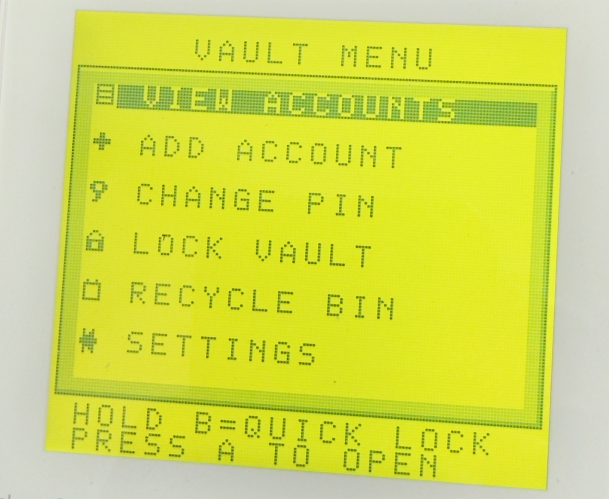

# GB Password Vault

[中文](README.md) | [English](README.en.md) | [日本語](README.ja.md)

> **Download**: [GitHub Releases](https://github.com/meyo/gb-passvault/releases/latest) — `passmgr.gb` + SHA-256

<p align="center">
  
  <br>
  <em>Running on real hardware (Game Boy DMG): VAULT MENU</em>
</p>

> Note: The authoritative implementation summary (`docs/05`) is currently available in Chinese only.

> ⚠️ **This project has moved to a real-hardware ROM path (compiled directly in C with GBDK-2020)**: the deliverable is `build/passmgr.gb` (**V0.3.7.4**,
> 255 slots + 20-character labels/usernames + 6-digit PIN + random password generator + 32KB SRAM save +
> recycle bin/auto-lock/generator settings + **2bpp graphical PIN screen** + **PMG5 dual-header/CRC16/WAL save protection**
> + **optional 12-digit recovery code**), with **357/357 automated tests passing**; **V0.3.7.3 has been verified on real hardware**
> (the three issues from V0.3.7.1 and the V0.3.7.2 lowercase-g glyph are fixed; V0.3.7.4 unifies the project name and fixes the empty-slot row, with the save format unchanged). **For the current state of the project, see
> [`docs/05-GBDK实机版实现总结.md`](docs/05-GBDK实机版实现总结.md)**.
> This README, `docs/01~04`, `plugins/`, and `assets/` are materials from the early GB Studio approach, kept for design reference only.
> The ASCII `+--+` segmented PIN screen from V0.3.3 is obsolete; V0.3.4 reworked it, based on `art/gb_login_filled.png`, into
> 2bpp graphical segments + raised keycaps. V0.3.5 widened the six segments from 2×3 to **3×3 tiles**.
> V0.3.6 added 9-slice panels/icons/headers and footers, menu and list selection bars, detail field cards, and the empty recycle-bin state;
> the PIN screen keeps the V0.3.5 look.
> **V0.3.6.1 fix**: the detail screen now has a fully closed border (the left and right borders are no longer missing); quick lock changed from
> `B+SELECT` to **holding B for about 1.5 seconds on non-input screens**; a short B press still goes back.
> **V0.3.7 save reliability**: PMG5 high-area dual headers A/B + CRC16 per record + write-ahead log (WAL);
> PMG4 saves are upgraded in place automatically at power-on without moving slots; damaged records show `SAVE DAMAGED`, and the rest of the data remains usable.
> **V0.3.7.1 forgotten PIN / toast**: after first-time setup or PMG3 migration you can **optionally** generate a **12-digit recovery code**;
> SRAM stores only two 64-bit hashes (`0x5730`/`0x5750`, CRC16 + WAL), **never the recovery code in plaintext**.
> Press `SELECT` on the PIN screen, or on the `SYSTEM LOCKED` screen after three failures, then enter the recovery code to reset the PIN.
> `SETTINGS` lets you create/replace/remove the recovery code. Transient messages such as save success are now a **centered rectangular label**
> (rows 8–10 are cleared first, then a 9-slice border + centered text).
> **V0.3.7.2 hardware fixes**: the detail screen now uses **`START` alone to edit and `SELECT+START` to delete**, reducing accidental deletions;
> the password input page now uses **2 lines × 18 cells**, so passwords of 16–36 characters are fully visible.
> **V0.3.7.4 maintenance update**: project name unified as **GB Password Vault**; fixed an out-of-bounds read in the empty-slot row that appended stray characters after `EMPTY`; PMG5 save format unchanged; 357/357 tests passing.
> **V0.3.7.3 glyph fix**: lowercase `g` now uses a Nintendo DMG-style single-storey glyph (upper bowl + bottom bar + right stem + left hook).
> **A note on lowercase `g`**: the ROM uses 8×8 tiles with a 5×7 glyph area, so lowercase letters have only 5 px of width.
> In earlier versions the single-storey `g` was easily confused with `9`, while the V0.3.7.2 double-storey `g` looked like a shrunken uppercase `G`.
> V0.3.7.3 uses the DMG-style single-storey `g`, which is distinguishable from both `9` and `G` on the keyboard, labels, usernames and passwords.
> Due to the 5 px limit, this is not a typographic double-storey `g`, but a readability compromise for a small dot-matrix font.
>
> **V0.3.7.4 quick start**: flash `build/passmgr.gb` (MBC1+RAM+BATTERY, requires a cartridge with ≥32KB SRAM save),
> set a **6-digit PIN** on first boot, then skip or generate a 12-digit recovery code. The PIN screen uses a `SECRET VAULT` title +
> six widened graphical segments + a raised numeric keypad (`CLR` clears all, `B` deletes one, `START` confirms).
> In the main menu, `ADD ACCOUNT` asks for a label (≤20), username (≤20, may be empty),
> password (≤36; the password page uses **2 lines × 18 cells** so long passwords are fully visible; press `SELECT` to generate a strong random password, press again to reroll).
> `VIEW ACCOUNTS` list: up/down moves one entry (hold to scroll continuously), **left/right pages through 12 entries**,
> **`SELECT` toggles the label/username view**; long selected labels scroll automatically.
> On the detail screen, hold `A` to reveal the password, **press `START` alone to edit**, **press `SELECT+START` together to delete** (**moves to the recycle bin**, recoverable).
> `SETTINGS` configures generated password length (12/16/24/32), symbols on/off, **auto-lock timeout (1/2/3/5/10 minutes)**,
> and **recovery code ON/OFF (create/replace/remove)**;
> `RECYCLE BIN` keeps the 16 most recently deleted entries: `A` restores, `SELECT` permanently deletes one, `START` clears all (all with confirmation).
> **Quick lock**: on menus/lists/details/settings/recycle bin, **hold B for about 1.5 seconds** to return to the PIN screen immediately;
> a short B press still goes back. Disabled on text-input and PIN-input screens (to avoid conflicts with `B=delete`).
>
> **Save protection**: when the PMG5 dual headers/CRC detect isolatable record damage, `SAVE DAMAGED` is shown;
> `A=CONTINUE` keeps using the remaining data, and the main menu shows `BAD nnn RECORDS`; a whole-vault checksum failure shows
> `SAVE CORRUPT`, and an unknown format shows `UNSUPPORTED SAVE`. Neither **is cleared automatically**;
> an explicit erase is performed only after `START` then `A`.
>
> **Upgrading from V0.3**: keep the battery-backed save; at power-on, enter the old **4-digit PIN** as prompted, then set a new **6-digit PIN**;
> old account labels and passwords migrate completely, usernames are left empty and can be filled in one by one. After migration you can optionally generate a recovery code.
> Do not power off while the migration screen shows `DO NOT POWER OFF`. After migration, the old V0.3 ROM cannot read the new save
> (the V0.3 baseline is kept in `archive/v0.3/`).
> **Upgrading from V0.3.1–V0.3.6**: PMG4 saves are upgraded in place to PMG5 automatically (dual headers/CRC/WAL),
> without moving slots or asking for the PIN again; after the upgrade, old PMG4 ROMs can still read the low-area mirror,
> but **writing with old versions is not recommended**. **Upgrading from V0.3.7 / V0.3.7.1 / V0.3.7.2 / V0.3.7.3 to V0.3.7.4**: the PMG5 save format is unchanged;
> just flash the new ROM, and an existing recovery code is preserved. **Back up (dump) your save before upgrading.**

## First clone / build

The repository does not commit the extracted `tools/gbdk/` or `tools/emu/node_modules/`, but it ships a pinned `tools/gbdk-macos.tar.gz`. After the first clone, run:

```bash
./tools/bootstrap.sh
./build.sh
node tools/emu/smoke.js
```

`bootstrap.sh` extracts GBDK and installs `serverboy` when the toolchain is missing; `build.sh` then produces `build/passmgr.gb`, and the smoke-test output is written to `test_out/smoke.log`.

> The following is material from the early **GB Studio 4.x** prototype (historical archive, not the current ROM implementation):
>
> A retro "offline password book" project skeleton + core logic scripts made with **GB Studio 4.x**,
> running on **real Game Boy / GBC hardware or an emulator**.

- 🕹 Main menu: view accounts / edit slots / change PIN / lock
- 🗄 Data model: 8 account slots × 12-character label + 12-character password (character-code arrays)
- 💾 Persistence: `Game Data Save/Load` (SRAM + battery backup), survives power-off
- ⌨️ Virtual keyboard: 48-key grid + D-pad cursor + A to confirm (plus a 4-digit numeric PIN keypad)
- 🔒 Unlock PIN: 4 digits, stored obfuscated with +7, entering it wrong 3 times triggers an easter egg
- 🧩 Optional plugin: turns "array read/write and XOR obfuscation" into three custom events (GBVM indirect addressing)

> ⚠️ Honest disclaimer: this is a toy-grade "ceremonial" password book; the SRAM contents can be read,
> so do not store real, important passwords (see `docs/04`, section 8).

---

## Directory structure

```
gbs-password-manager/
├── README.md                       ← 中文 (Chinese)
├── README.en.md                    ← you are here
├── README.ja.md                    ← 日本語 (Japanese)
├── docs/
│   ├── 01-架构与场景规划.md          ← 6 scenes, transition diagram, background drawing
│   ├── 02-核心事件逻辑.md            ← GB Studio event recipes + pseudocode for each scene
│   ├── 03-变量表与数据模型.md        ← how the 512 variables are divided, contiguous-range conventions
│   └── 04-开发注意事项与坑.md        ← hardware/engine/text/save pitfalls
├── plugins/
│   └── password-manager/
│       ├── README.md               ← plugin installation and usage
│       └── events/
│           ├── eventPmArrayWrite.js    ← array write (indirect addressing)
│           ├── eventPmArrayRead.js     ← array read
│           └── eventPmObfuscate.js     ← XOR obfuscate/restore
└── assets/
    └── keymap-table.csv            ← 48-key mapping table (fed to Data Table Lookup)
```

## Quick start

1. Create a new project in GB Studio 4.3+ → choose a cartridge type **with BATTERY** (Project Settings);
2. Open `docs/03` and rename the variables in numeric order (do not break the contiguous ranges);
3. (Optional) Copy `plugins/password-manager` into the project's `plugins/` directory,
   restart the editor → a **Password Manager** group appears in the event list;
4. Build the 6 scenes and static backgrounds per `docs/01`, and paste the events per `docs/02`;
5. Run the "playthrough self-test checklist" in `docs/02`, section 10.

## Recommended reading order

- To understand the structure first: `01` → `03` → `02`
- To start building right away: `03` (create variables) → `02` (paste logic) → `04` (diff when you hit problems)
- To learn GBVM / plugins: `plugins/password-manager/README.md` + `04`, section 7

## Version notes

- Target: GB Studio **4.3.x (stable)**; 4.2 and earlier can use the "pure visual alternative" (`02`, section 8);
- After 4.4 dev introduces **native array variables**, the plugin usage can be replaced directly; the data model does not need to change.
